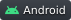

## 1 Hi, I'm Sagi

Software developer and third-year CS student at Afeka (GPA 90.9).

I build Android apps in Kotlin and Jetpack Compose, with tested business logic and a design
system of my own. Before that, I spent 4+ years in IT infrastructure: sysadmin in the IDF, then
Microsoft Support Engineer at We Ankor (Microsoft 365, Azure, Intune, on-prem AD and Exchange).

**Open to student roles in development, DevOps or cloud, 2–3 days/week**, and planning to stay on
after graduation.

## 2 Stack

**Languages:**&nbsp;     

**Android:**&nbsp;     

**Data & Tools:**&nbsp;      

**IT & Cloud:**&nbsp;     

## 3 Featured Projects

### 3.1 [MonoTask](https://github.com/sagieinav/android-mono-task)

A gamified Android task manager that shows one task at a time. Built solo, shipped in
[3 beta releases](https://github.com/sagieinav/android-mono-task/releases), and used daily as my own planner.
 

- **Design system:** 34 Compose components across 8 screens, a custom swipe-gesture engine, Canvas-drawn charts
- **Hybrid MVVM + MVI:** one immutable State per screen; one-shot Effects on a separate channel, so they never replay on rotation
- **Task-picking algorithm:** a logistic urgency curve, weighted against importance and penalized per snooze
- **Real-time data:** Firestore streamed as Flows; streak and XP stats update in a single transaction
- **87 unit tests** (JUnit 5, AssertK) on XP, achievements, task selection and undo/restore

### 3.2 [George The Vetrinator](https://github.com/sagieinav/edu-vetrinator-game-android)

My first Android app, a pixel-art arcade game parodying the sitcom *Haparlament*. Tilt input runs
through a low-pass filter and a neutral zone, so one tilt moves exactly one lane. High scores are
pinned on a Google Maps leaderboard. *(Kotlin · Android sensors · Google Maps SDK)*
 

## 4 Now

- **Full-stack web:** React, Node.js / Express and PostgreSQL, from first screen to deployment
- **AI-assisted development:** building with AI coding tools while understanding and owning every line, not vibe coding
