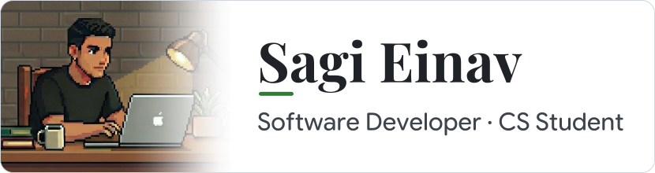
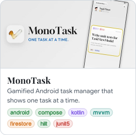
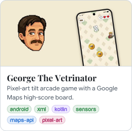

<!-- gen:banner -->
<picture><source media="(prefers-color-scheme: dark)" srcset="assets/gen/banner-dark.5a476d6d.svg"></picture>
<!-- /gen:banner -->

Third-year CS student at Afeka (GPA 90.9). I build Android apps in Kotlin and Jetpack Compose, and I'm now expanding into Compose Multiplatform, full-stack web and disciplined AI-assisted development.

Before that, 4+ years in IT infrastructure: sysadmin in the IDF, then Microsoft Support Engineer at We Ankor (Microsoft 365, Azure, Intune, AD, Exchange).

> [!NOTE]
> **Open to student roles in development, DevOps or cloud, 2–3 days/week.**

## Main Skills

<!-- gen:skills -->
<picture><source media="(prefers-color-scheme: dark) and (max-width: 430px)" srcset="assets/gen/label-languages-dark-330.21b7d072.svg"><source media="(max-width: 430px)" srcset="assets/gen/label-languages-light-330.af2df5ff.svg"><source media="(prefers-color-scheme: dark) and (max-width: 767px)" srcset="assets/gen/label-languages-dark-560.8d489e5b.svg"><source media="(max-width: 767px)" srcset="assets/gen/label-languages-light-560.462bd3df.svg"><source media="(prefers-color-scheme: dark)" srcset="assets/gen/label-languages-dark-170.288438e4.svg"></picture> <a href="https://kotlinlang.org"><picture><source media="(max-width: 767px)" srcset="assets/gen/icon-kotlin-phone.c24cf066.svg"></picture></a><a href="https://dev.java"><picture><source media="(max-width: 767px)" srcset="assets/gen/icon-java-phone.199bdb1a.svg"></picture></a><a href="https://www.python.org"><picture><source media="(max-width: 767px)" srcset="assets/gen/icon-python-phone.fcca5194.svg"></picture></a><a href="https://www.c-language.org"><picture><source media="(max-width: 767px)" srcset="assets/gen/icon-c-phone.d6384a48.svg"></picture></a><a href="https://www.gnu.org/software/bash/"><picture><source media="(max-width: 767px)" srcset="assets/gen/icon-bash-phone.b81e1d45.svg"></picture></a><a href="https://www.iso.org/standard/76583.html"><picture><source media="(max-width: 767px)" srcset="assets/gen/icon-sql-phone.3583a575.svg"></picture></a> 
<picture><source media="(prefers-color-scheme: dark) and (max-width: 430px)" srcset="assets/gen/label-android-dark-330.0c251345.svg"><source media="(max-width: 430px)" srcset="assets/gen/label-android-light-330.d2af23ed.svg"><source media="(prefers-color-scheme: dark) and (max-width: 767px)" srcset="assets/gen/label-android-dark-560.51432f5d.svg"><source media="(max-width: 767px)" srcset="assets/gen/label-android-light-560.8e3c46c5.svg"><source media="(prefers-color-scheme: dark)" srcset="assets/gen/label-android-dark-170.cf65b1e3.svg"></picture> <a href="https://developer.android.com"><picture><source media="(max-width: 767px)" srcset="assets/gen/icon-android-phone.8b4eb57b.svg"></picture></a><a href="https://developer.android.com/compose"><picture><source media="(max-width: 767px)" srcset="assets/gen/icon-compose-phone.1d5d8ccd.svg"></picture></a><a href="https://firebase.google.com"><picture><source media="(max-width: 767px)" srcset="assets/gen/icon-firebase-phone.f360c8d8.svg"></picture></a> 
<picture><source media="(prefers-color-scheme: dark) and (max-width: 430px)" srcset="assets/gen/label-tools-cloud-dark-330.42406011.svg"><source media="(max-width: 430px)" srcset="assets/gen/label-tools-cloud-light-330.d9293488.svg"><source media="(prefers-color-scheme: dark) and (max-width: 767px)" srcset="assets/gen/label-tools-cloud-dark-560.df940619.svg"><source media="(max-width: 767px)" srcset="assets/gen/label-tools-cloud-light-560.00e94f7f.svg"><source media="(prefers-color-scheme: dark)" srcset="assets/gen/label-tools-cloud-dark-170.a5983533.svg"></picture> <a href="https://git-scm.com"><picture><source media="(max-width: 767px)" srcset="assets/gen/icon-git-phone.1e5d0e9b.svg"></picture></a><a href="https://www.docker.com"><picture><source media="(max-width: 767px)" srcset="assets/gen/icon-docker-phone.4abd4c2f.svg"></picture></a><a href="https://www.postgresql.org"><picture><source media="(max-width: 767px)" srcset="assets/gen/icon-postgresql-phone.4aeb533f.svg"></picture></a><a href="https://azure.microsoft.com"><picture><source media="(max-width: 767px)" srcset="assets/gen/icon-azure-phone.3bab87d3.svg"></picture></a><a href="https://learn.microsoft.com/powershell/"><picture><source media="(max-width: 767px)" srcset="assets/gen/icon-powershell-phone.abbc552d.svg"></picture></a><a href="https://www.microsoft.com/windows"><picture><source media="(max-width: 767px)" srcset="assets/gen/icon-windows-phone.3e3cea71.svg"></picture></a>
<!-- /gen:skills -->

### Studying

<!-- gen:studying -->
<picture><source media="(prefers-color-scheme: dark) and (max-width: 430px)" srcset="assets/gen/label-full-stack-web-dark-330.52d20922.svg"><source media="(max-width: 430px)" srcset="assets/gen/label-full-stack-web-light-330.850e7b0a.svg"><source media="(prefers-color-scheme: dark) and (max-width: 767px)" srcset="assets/gen/label-full-stack-web-dark-560.1cd4d432.svg"><source media="(max-width: 767px)" srcset="assets/gen/label-full-stack-web-light-560.aaab8b17.svg"><source media="(prefers-color-scheme: dark)" srcset="assets/gen/label-full-stack-web-dark-170.11315919.svg"></picture> <a href="https://react.dev"><picture><source media="(max-width: 767px)" srcset="assets/gen/icon-react-phone.c76017bb.svg"></picture></a><a href="https://nodejs.org"><picture><source media="(max-width: 767px)" srcset="assets/gen/icon-nodejs-phone.10e322d8.svg"></picture></a><a href="https://www.typescriptlang.org"><picture><source media="(max-width: 767px)" srcset="assets/gen/icon-typescript-phone.15f076d6.svg"></picture></a><a href="https://tc39.es"><picture><source media="(max-width: 767px)" srcset="assets/gen/icon-javascript-phone.f5e8cd1b.svg"></picture></a><a href="https://html.spec.whatwg.org"><picture><source media="(max-width: 767px)" srcset="assets/gen/icon-html-phone.63644467.svg"></picture></a><a href="https://www.w3.org/Style/CSS/"><picture><source media="(max-width: 767px)" srcset="assets/gen/icon-css-phone.c8308c65.svg"></picture></a> 
<picture><source media="(prefers-color-scheme: dark) and (max-width: 430px)" srcset="assets/gen/label-ai-llm-dev-dark-330.5502bb01.svg"><source media="(max-width: 430px)" srcset="assets/gen/label-ai-llm-dev-light-330.69437dea.svg"><source media="(prefers-color-scheme: dark) and (max-width: 767px)" srcset="assets/gen/label-ai-llm-dev-dark-560.071031b8.svg"><source media="(max-width: 767px)" srcset="assets/gen/label-ai-llm-dev-light-560.36c57901.svg"><source media="(prefers-color-scheme: dark)" srcset="assets/gen/label-ai-llm-dev-dark-170.3effa5f5.svg"></picture> <a href="https://claude.com/product/claude-code"><picture><source media="(max-width: 767px)" srcset="assets/gen/icon-claudecode-phone.4a9cbd0b.svg"></picture></a><a href="https://www.langchain.com"><picture><source media="(max-width: 767px)" srcset="assets/gen/icon-langchain-phone.75e99dbf.svg"></picture></a><a href="https://modelcontextprotocol.io"><picture><source media="(max-width: 767px)" srcset="assets/gen/icon-mcp-phone.6f91a4bc.svg"></picture></a><a href="https://www.crewai.com"><picture><source media="(max-width: 767px)" srcset="assets/gen/icon-crewai-phone.32089d86.svg"></picture></a>
<!-- /gen:studying -->

- **Full-stack web:** a React + Node.js + PostgreSQL app, from first screen to cloud deployment
- **LLM apps:** agents, RAG and MCP servers, built with AI tools where I own every line
- **Next up:** taking Compose to Compose Multiplatform for my final project

## Featured Projects

<!-- gen:projects -->
<a href="https://github.com/sagieinav/android-mono-task"><picture><source media="(prefers-color-scheme: dark)" srcset="assets/gen/card-monotask-dark.be107180.svg"></picture></a>&nbsp; <a href="https://github.com/sagieinav/edu-vetrinator-game-android"><picture><source media="(prefers-color-scheme: dark)" srcset="assets/gen/card-vetrinator-dark.d2792455.svg"></picture></a>
<!-- /gen:projects -->

## Contact Me

<!-- gen:contact -->
<a href="https://www.linkedin.com/in/sagi-einav/"><picture><source media="(prefers-color-scheme: dark)" srcset="assets/gen/contact-linkedin-dark.3efce4e8.svg"></picture></a> <a href="mailto:sagi.einav@icloud.com"><picture><source media="(prefers-color-scheme: dark)" srcset="assets/gen/contact-email-dark.e4d5eaab.svg"></picture></a>
<!-- /gen:contact -->

> [!IMPORTANT]
> **Recruiter?** [Download my resume](https://github.com/sagieinav/sagieinav/raw/main/assets/cv/Sagi_Einav_CV.pdf).
